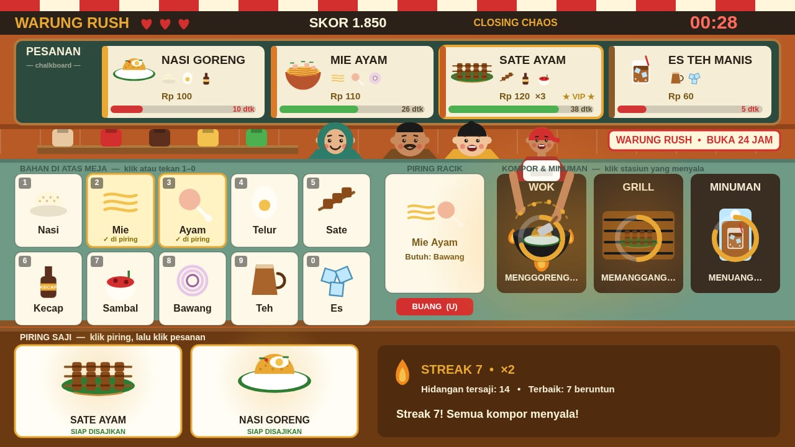

# Warung Rush

An Indonesian street-food stall cooking game — run a warung kaki lima, cook
orders fast, and serve every customer before their patience runs out.

Built for the make.fun bounty **best-cooking-game-20261125-0137**.

## Trailer

▶️ [Watch the trailer (18 seconds)](assets/warung-rush-trailer.mp4)

## How to Play

**Goal:** serve every customer's order before their patience bar runs out.
You have one 150-second shift and 3 hearts — an order that expires costs a
heart. Lose all 3 hearts and the shift ends early.

1. **Read the ticket.** Each customer shows the dish they want.
2. **Add ingredients to the pan.** Press keys `1`–`0` (or click the
   ingredient buttons).
3. **Cook it.** Click the matching station — **WOK** (Nasi Goreng, Mie
   Ayam), **GRILL** (Sate Ayam), **MINUMAN** (Es Teh Manis). The exact
   ingredient set matters; extra ingredients block the recipe.
4. **Serve it.** Click the finished dish to pick it up, then click the
   matching customer ticket. Serving the wrong ticket shakes it and costs
   50 points.
5. **Clear the pan** with the `U` key or the Trash button.

| Dish | Ingredients | Station | Cook | Pays |
| --- | --- | --- | --- | --- |
| Nasi Goreng | Nasi `1` + Telur `4` + Kecap `6` | WOK | 3.0s | 100 |
| Mie Ayam | Mie `2` + Ayam `3` + Bawang `8` | WOK | 3.2s | 110 |
| Sate Ayam | Sate `5` + Kecap `6` + Sambal `7` | GRILL | 3.5s | 120 |
| Es Teh Manis | Teh `9` + Es `0` | MINUMAN | 1.5s | 60 |

**Keys:** `Enter` / `Space` start · `1`–`0` add ingredients · `U` clear
pan · `M` mute · `R` restart after game over. Mouse works too — click
ingredients, stations, dishes, and tickets.

## Scoring

- Base price per dish, plus a speed bonus: **+50** served with more than
  half the customer's patience left, **+20** with more than a quarter.
- **Streak multiplier** for consecutive serves: x1.5 at 3 in a row, x2 at 6,
  x3 at 10.
- **VIP customers** (final phase only) pay **3x** — but wait less patiently.
- Wrong serve: **−50** points.

## The rush

The 150-second shift has three phases: **PEMBUKAAN** → **RUSH HOUR** →
**CLOSING CHAOS**. Orders arrive faster and customers get less patient as
the shift goes on. Es Teh is the fast relief dish when the tickets pile up.

## Run it

Open `game/index.html` in a browser — no build step, no server, no
dependencies, no network. Pure HTML/CSS/JS (canvas rendering, Web Audio
for sound effects).
